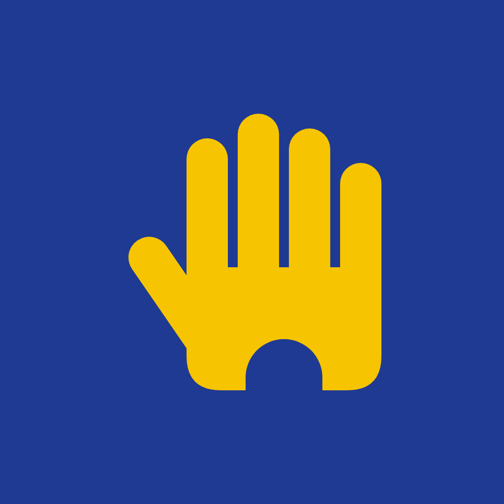
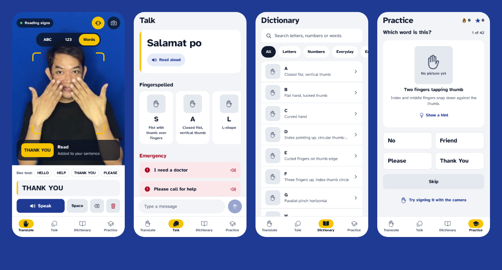

<p align="center">
  
</p>

<h1 align="center">SignBridge</h1>

<p align="center">
  Reads Filipino Sign Language (FSL) from the camera and turns it into text and speech.<br />
  Works fully offline. Video never leaves the device.
</p>



<sub>The Translate screen above is reading a test clip from the FSL-105 dataset, played into the app as its camera.</sub>

## What it does

- **Translate:** sign in front of the camera and each recognised word is added to a
  sentence, which the phone can read aloud. It recognises the 105 everyday FSL words
  and phrases in [FSL-105](https://data.mendeley.com/datasets/48y2y99mb9/2): greetings,
  family, days, months, colours, food and more.
- **Talk:** for face-to-face conversations. A hearing person types and the message
  shows in large text, with emergency phrases and quick replies one tap away.
- **Dictionary:** search letters, numbers and words, with a detail page for how to form
  each sign.
- **Practice:** a quiz that shows a handshape and asks which sign it is.

## Results

The classifier was trained on FSL-105's own training split and evaluated once on its
held-out test split (426 clips):

| Measure | Result |
| --- | --- |
| Top-1 accuracy (test clips) | **96.0%** |
| Top-5 accuracy (test clips) | 99.8% |
| Top-1 when clips are cut into signs the way the live app does it | 90.9% |

The gap between the first and third rows is the realistic one. The live app has to find
where each sign starts and ends in a continuous video stream, and that sometimes adds an
extra segment, for example when the hands drop after a sign. The weakest signs are some
months and numbers (AUGUST, SEVEN), which look alike in motion. Full metrics:
[`FSL/assets/models/fsl105/metrics.md`](FSL/assets/models/fsl105/metrics.md).

## How it works

```
camera ─► hand + body points ─► find where a sign starts and ends ─► classifier ─► sentence ─► speech
          (MediaPipe, on device)  (motion-based segmenter)            (1-D CNN)
```

1. **Hand and body points.** Google's MediaPipe finds 21 points on each hand plus the
   shoulders, elbows and wrists in every frame. These are normalised to the shoulders, so
   the model doesn't care where you stand or how far away you are. Many FSL words differ by
   *where* the hand is (face, chest), which is why the body points matter.
2. **Segmentation.** A sign starts when a hand moves and ends after about 300 ms of
   stillness. Each sign is resampled to 32 frames.
3. **Classification.** A small 1-D convolutional network (600 KB) scores the 105 signs.
   It runs in about 150 lines of plain TypeScript written for this app, so the same
   code runs in the browser and on the phone with no ML library. A test checks it
   matches Keras's output to within 0.0001.
4. **Decision.** A sign is only added when the model is confident and clearly ahead of
   its second guess. Otherwise the app shows "Not sure yet" with the top two guesses to tap.

**Privacy.** Everything runs on the device. MediaPipe's web build normally sends usage
statistics to Google; that is disabled, and an automated test keeps the app reading
signs for 75 seconds and fails if any request leaves the machine.

## Running it

### In a browser (laptop webcam)

Needs [Node.js](https://nodejs.org) 20 or later.

```bash
git clone https://github.com/JcXplore/SignLanguage-ML-.git
cd SignLanguage-ML-/FSL
npm install
npx expo start --web
```

Open the address it prints in Chrome and allow the camera. Stand back far enough that
your shoulders are in view, sign a word, then hold still for a moment. It keeps working
with Wi-Fi off.

### On Android

The Android app uses a native hand-tracking module
([`FSL/modules/hand-tracker`](FSL/modules/hand-tracker), Kotlin with CameraX and MediaPipe),
so it needs its own build rather than Expo Go. An APK is available under
[Releases](https://github.com/JcXplore/SignLanguage-ML-/releases) when published. To build
one yourself, install Android Studio, then:

```bash
cd FSL
npx expo run:android --variant release
```

### Retraining the model

See [`ml/README.md`](ml/README.md): download FSL-105, extract the points, train, export,
and run the tests.

## Project layout

| Path | What's there |
| --- | --- |
| [`FSL/`](FSL) | The Expo / React Native app (web and Android) |
| [`FSL/src/recognition/`](FSL/src/recognition) | Features, segmentation, the model runner and the decision logic, with tests |
| [`FSL/modules/hand-tracker/`](FSL/modules/hand-tracker) | Native Android hand and pose tracking |
| [`ml/`](ml) | Python: point extraction, training, export, evaluation |
| [`docs/superpowers/`](docs/superpowers) | The design document and implementation plan |

## Tests

```bash
cd FSL && npm run test:recognition && npx tsc --noEmit
cd ml && .venv/bin/python -m pytest -q
```

End-to-end checks in `FSL/e2e/` play FSL-105 test clips into a browser as a fake webcam
with all outside network blocked.

## Limitations and next steps

- **Words only so far.** Letters (A–Z plus Ñ and NG) and numbers aren't trained yet; the
  ABC and 123 modes say so.
- **Not yet tested by an FSL signer.** The accuracy figures come from the dataset's test
  videos, not a live user study.
- **Android build not yet tried on a phone.** It builds and contains the models, but
  hasn't been run on a device yet. iPhone isn't supported yet.
- **Dictionary text needs FSL review.** The written descriptions in the Dictionary and
  Practice screens started from ASL and need checking by an FSL signer. The recognition
  model itself is trained only on FSL signers.
- **No sign pictures yet.** The Dictionary shows "No picture yet" until real photos of an
  FSL signer are added.

## Credits

- **[FSL-105](https://data.mendeley.com/datasets/48y2y99mb9/2)** by Isaiah Jassen Tupal
  (2023), CC BY 4.0. 105 FSL signs performed by Deaf FSL signers and checked by an FSL expert.
- **[MediaPipe](https://ai.google.dev/edge/mediapipe)** by Google, Apache 2.0: hand and
  pose tracking.
- **[Atkinson Hyperlegible](https://www.brailleinstitute.org/freefont/)** by the Braille
  Institute, SIL Open Font License: the app's typeface.
- Built with [Expo](https://expo.dev) and React Native.
